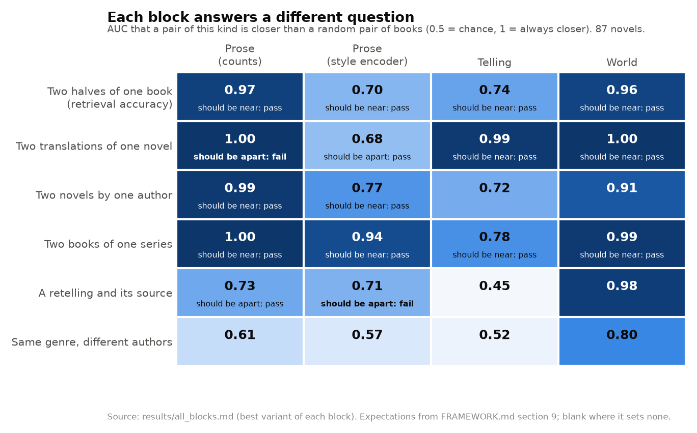
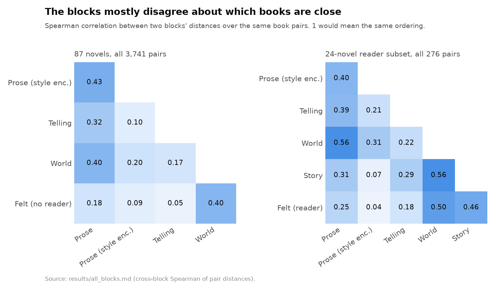
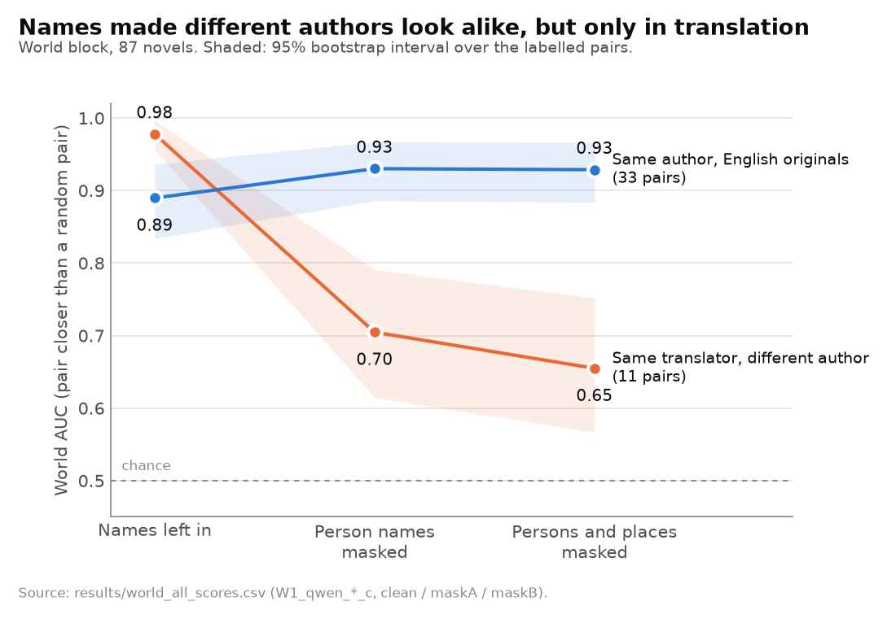
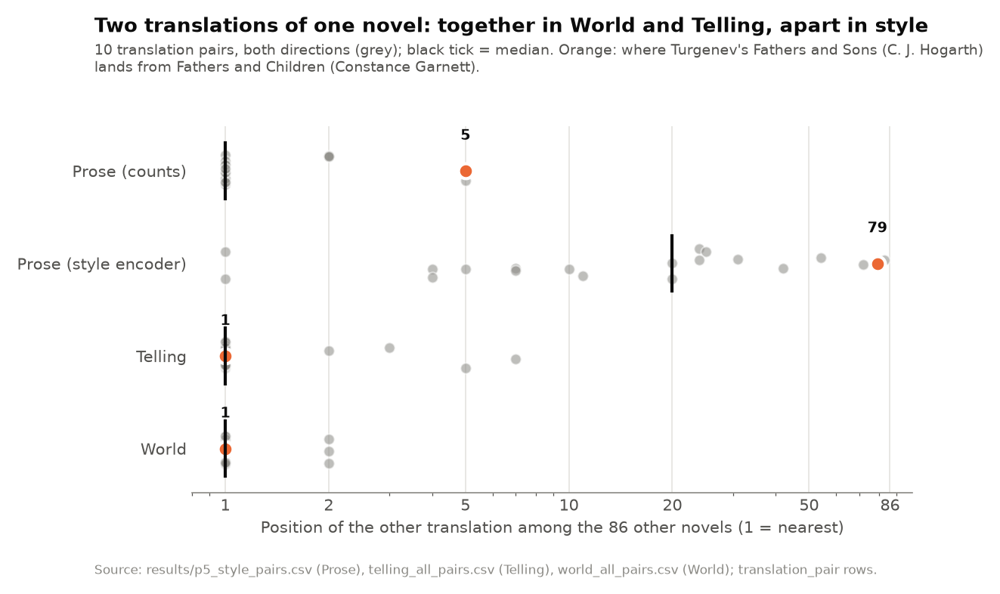

# book2vec figures

Four figures from the proof of concept on 87 public-domain novels. They are drawn from numbers
already in [`../results/`](../results/); no model was run to make them. The full write-up of
round two is [`round2.md`](../results/round2.md) and the one-table summary is
[`all_blocks.md`](../results/all_blocks.md). Round one (Prose and Telling) is
[`prose_telling.md`](../results/prose_telling.md).

AUC in these figures is the chance that a labelled pair of books (two translations, two books
by one author, and so on) is closer than a pair with no known relation. 0.5 is chance.

Regenerate with:

    uv run --with matplotlib --with pandas python experiments/book2vec/figures/make_figures.py

## Each block passes different tests

Each cell is a block's AUC on one kind of pair, with the expectation from section 9 of
[FRAMEWORK.md](../../../src/art2vec/book2vec/FRAMEWORK.md) where it sets one. Count-based
Prose puts two translations of one novel together (1.00) where the framework expects them
apart; the style encoder puts them apart (0.68). Numbers from
[`all_blocks.md`](../results/all_blocks.md), best variant of each block.

## The blocks mostly disagree

Spearman correlation between two blocks' distances over the same book pairs. On 87 novels no
two blocks go above 0.43. Story and Felt exist only for the 24 novels a language-model reader
went through. Numbers from [`all_blocks.md`](../results/all_blocks.md), cross-block Spearman
tables.

## Names made Garnett's translations look alike

World block on passages with names left in, person names replaced, and person and place names
replaced. Constance Garnett's translations of different Russian authors (11 pairs) drop from
0.98 to 0.65; pairs of English novels by one author (33 pairs) do not drop. Numbers from
[`world_all_scores.csv`](../results/world_all_scores.csv); discussed in
[`round2.md`](../results/round2.md) and [`world_all.md`](../results/world_all.md).

## Where a novel's other translation lands

For each of the 10 translation pairs, where the other translation ranks among the 86 other
novels, under each block. Count-based Prose, Telling and World put it first in 16 or 17 of 20
cases; the style encoder puts it a median of 20th. Orange is Turgenev's Fathers and Sons: Hogarth's translation is 5th from
Garnett's in Prose, 79th with the style encoder, and 1st in Telling and World. Ranks from the
`translation_pair` rows of [`p5_style_pairs.csv`](../results/p5_style_pairs.csv),
[`telling_all_pairs.csv`](../results/telling_all_pairs.csv) and
[`world_all_pairs.csv`](../results/world_all_pairs.csv).
