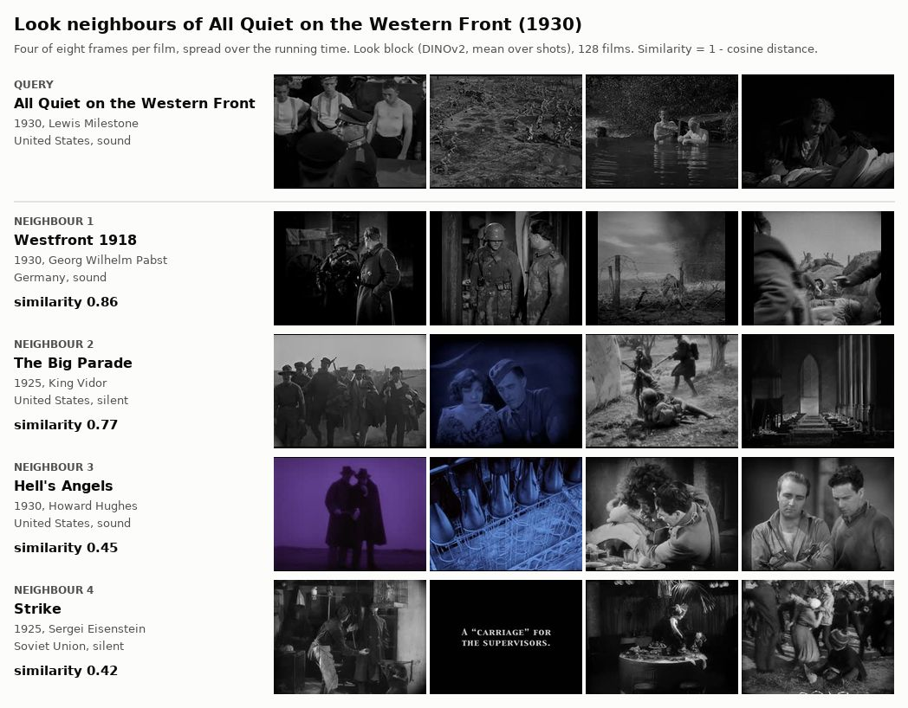
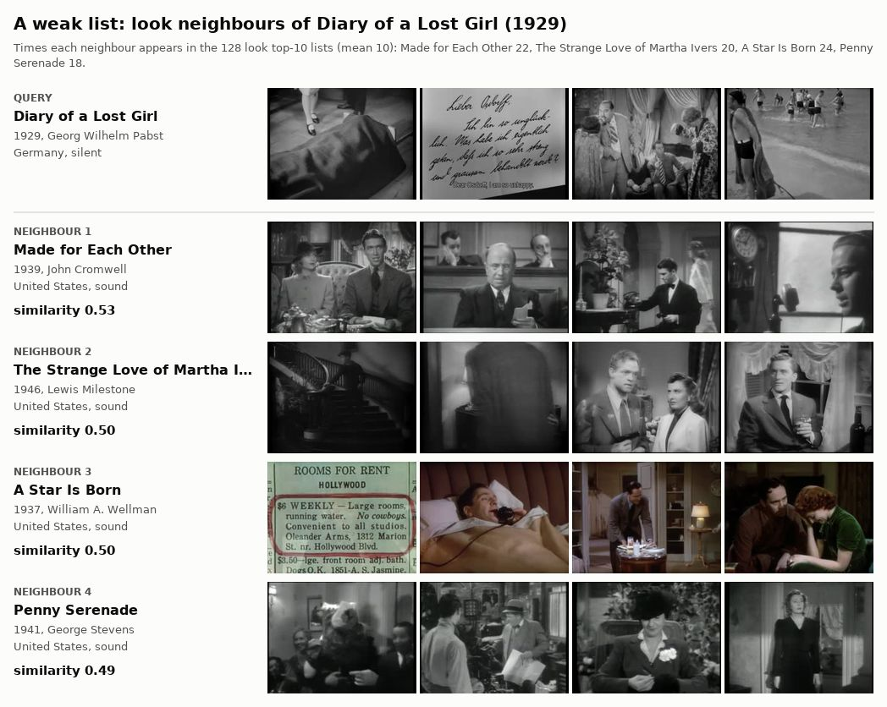
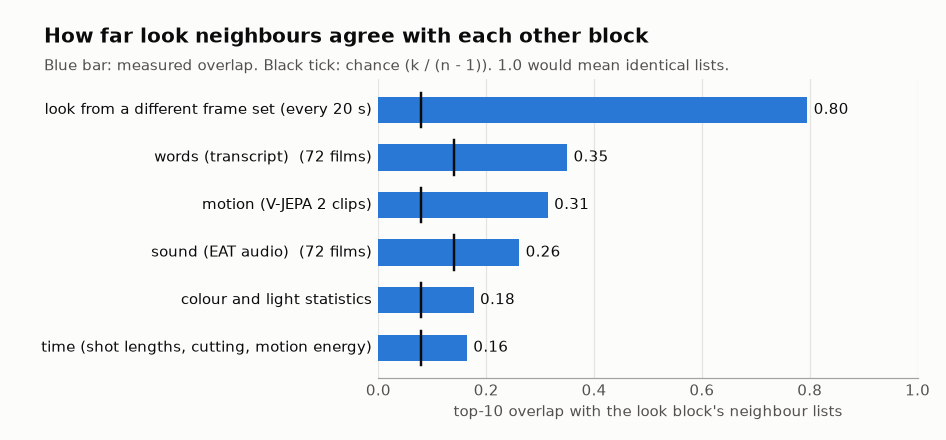
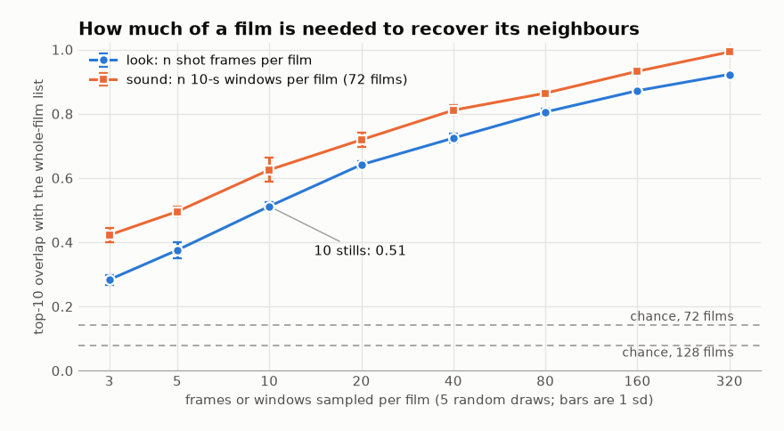
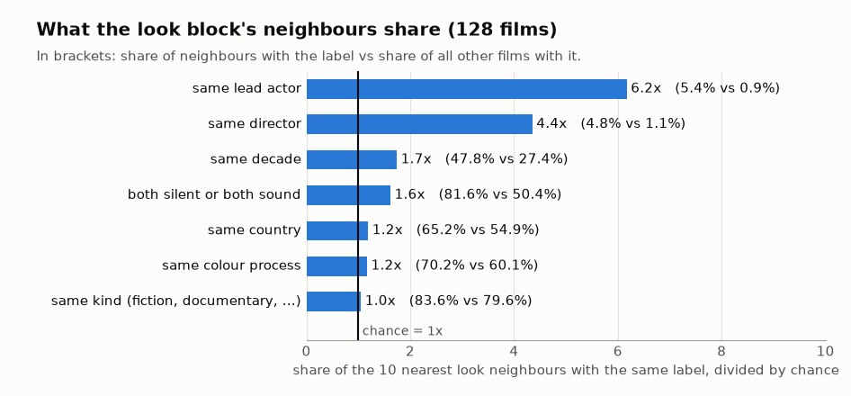

# film2vec proof of concept: figures

These figures come from the film2vec experiments on 128 films from 1916 to 1968 that are in the US public domain (`../catalog.csv`). The tables behind them are in [`../results/RESULTS.md`](../results/RESULTS.md). The frames are small thumbnails of those films, four of eight per film, spread over the running time. Similarity on the contact sheets is 1 minus the cosine distance in `neighbours.json`.

To rebuild them from the existing results and thumbnails (no model is run):

```bash
uv run --with matplotlib --with pillow python experiments/film2vec/figures/make_figures.py
```

## A neighbour list that works



The nearest films to All Quiet on the Western Front (1930) in the look block are Westfront 1918, The Big Parade, Hell's Angels and Strike. The first three are First World War films by three other directors. Source: `results/neighbours.json`.

## A neighbour list that does not



Diary of a Lost Girl, a German silent from 1929, gets four American sound films from 1937 to 1946. Each of them appears in 18 to 24 of the 128 look top-10 lists, against a mean of 10; Pabst's Pandora's Box comes fifth. Sources: `results/neighbours.json`, and the hubness table in RESULTS.md section 5.

## The blocks give different neighbours



Look built from a different set of frames keeps 80% of the look top-10 lists. Words, motion, sound, colour and time keep 16% to 35%: above chance, but mostly different films. Source: `results/results.json`, experiment 1 (RESULTS.md section 1).

## How much of a film is needed



The look block built from 10 random shot frames per film shares 51% of its top-10 lists with the whole-film version, and 87% with 160 frames. The sound block behaves the same way with 10-second windows. Source: `results/results.json`, experiment 3 (RESULTS.md section 3).

## What look neighbours share



Look neighbours share a lead actor 6.2 times as often as chance and a director 4.4 times as often, though both are rare (5.4% and 4.8% of neighbours). They are also more often from the same decade and on the same side of the silent/sound line. Source: `results/results.json`, experiment 5 (RESULTS.md section 5).
