# painting2vec figures

A selection of the contact sheets and plots from the experiments, small enough to commit. The full sets are written under `data/painting2vec/` (gitignored) by each experiment's sheet script. `make_figures.py` copies the sheets below into this folder at 1,400 px on the long side.

Every number and observation in the captions comes from the experiment's own README. The sheets were looked at by a model, not a person.

## Experiment 1: can subject and manner be kept apart?

[exp_separation/README.md](../exp_separation/README.md)

Each sheet has the seed painting on the left and its eight nearest neighbours in each of eight rows, one row per candidate block. No names are shown. Rows: A DINOv2-L `cls` (subject), B SigLIP 2 (subject), C DINOv2-L `cls` minus CSD style, D DINOv2-L second-order statistics (manner), E DINOv2-L `meanstd_mid`, F CSD style (manner), G CSD style minus DINOv2-L `cls`, H `meanstd_mid` minus DINOv2-L `cls`.

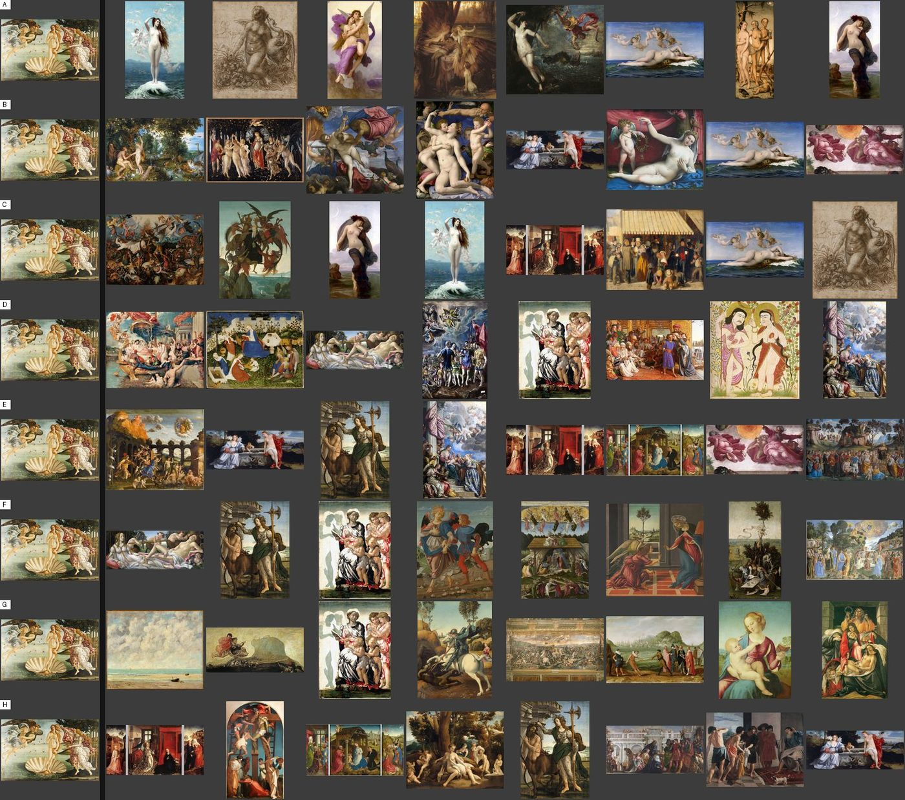

Botticelli's *Birth of Venus*. Row A returns standing nudes by the sea from Bouguereau, Cabanel, Titian and a Leonardo drawing. Row F returns four Botticellis on other subjects: *Venus and Mars*, an annunciation, a nativity and a centaur.

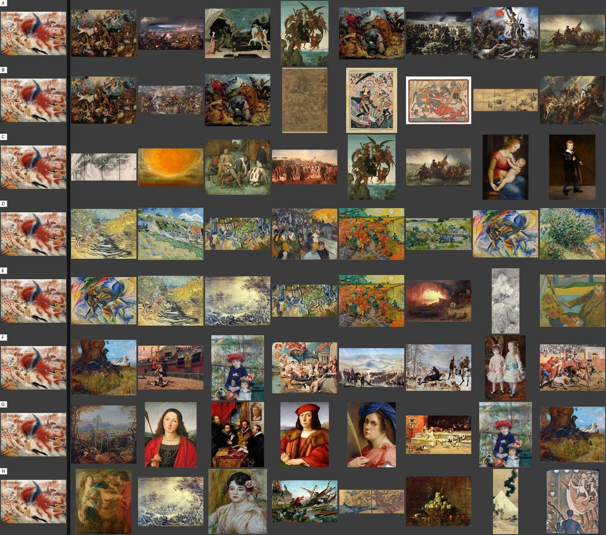

Boccioni's *The City Rises*. Row A returns turbulent masses of bodies: Bruegel's rebel angels, a Rubens hunt, *Liberty Leading the People*. Row D returns six Van Goghs and Boccioni's cyclist, which share broken directional strokes in high colour and none of its subject.

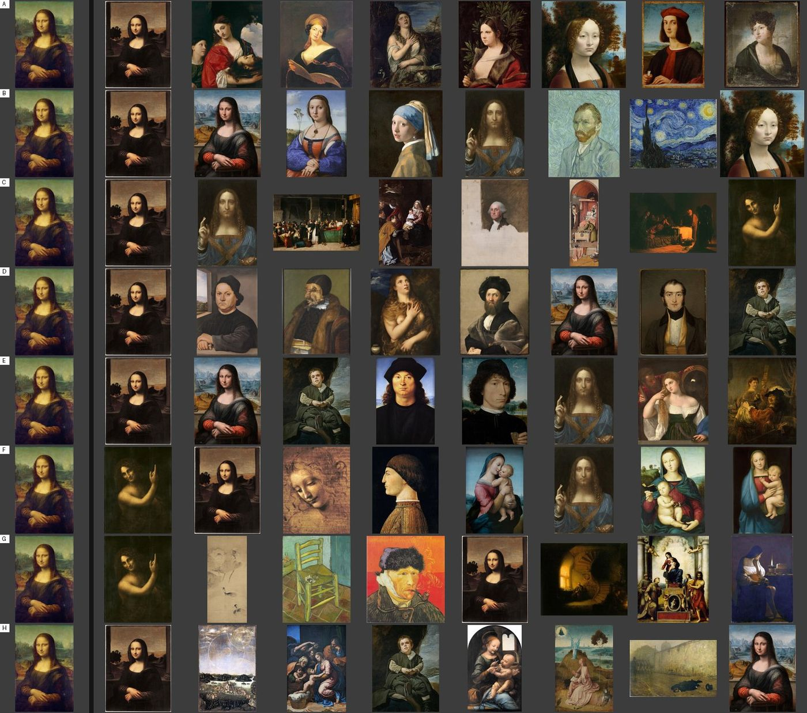

The *Mona Lisa*. Row B (SigLIP 2) includes *The Starry Night*, a Van Gogh self-portrait and the *Girl with a Pearl Earring*, links of reputation rather than appearance. Row F returns three Leonardos and three Raphael Madonnas.

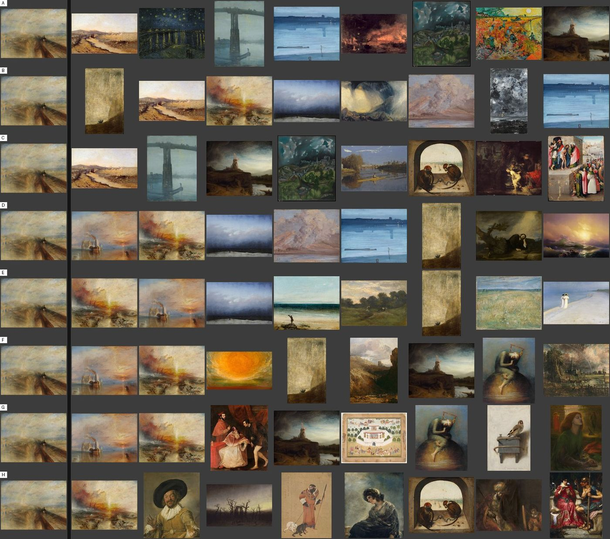

Turner's *Rain, Steam and Speed*. Row D returns two more Turners, then Friedrich, Whistler, Aivazovsky, Kuroda's volcano and Goya's dog: forms dissolved in atmosphere, by five other painters.

## Experiment 2: how much does the photograph move a painting?

[exp_invariance/README.md](../exp_invariance/README.md)

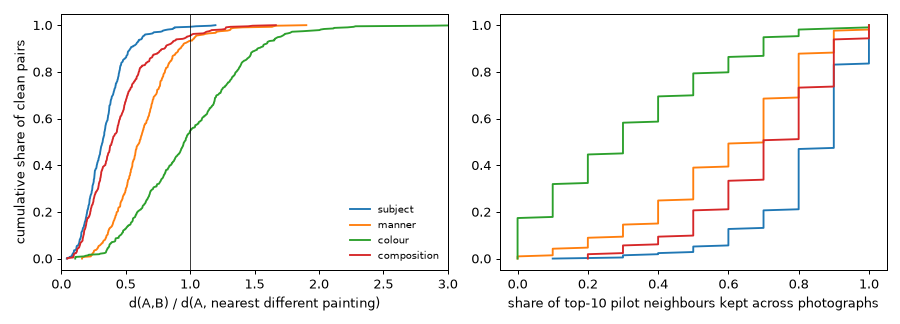

For 214 clean pairs of photographs of one painting. Left: the distance between the two photographs divided by the distance to the nearest different painting (under 1 means the pair is closer than any other painting). Right: the share of a top-10 neighbour list kept when the photograph changes.

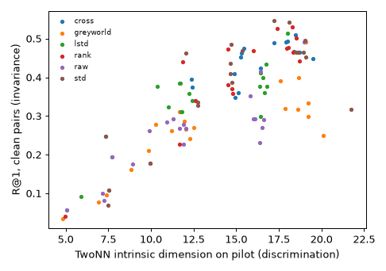

Colour variants: R@1 on clean pairs against intrinsic dimension on the pilot set. No colour variant passes. The best scores 0.547, and the more photograph-proof normalisations also have the higher intrinsic dimension.

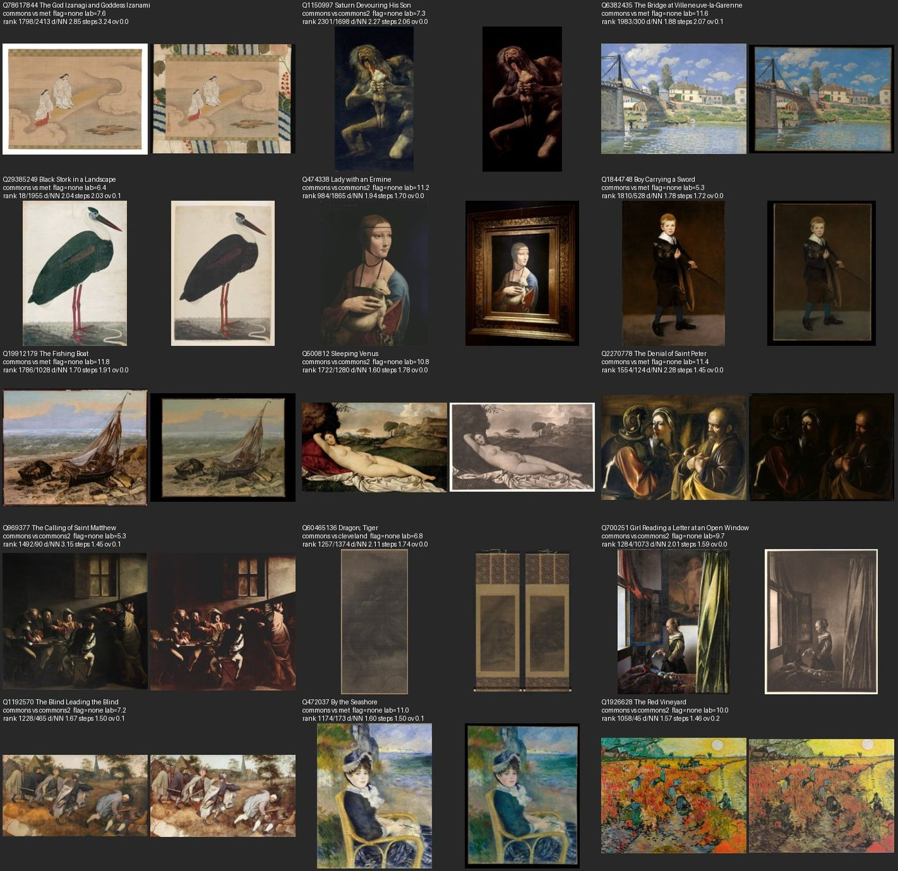

The fifteen clean pairs the colour block ranks worst. In 7 one photograph includes a border, mount or frame, 6 differ in exposure or saturation, and 2 are unflagged monochrome scans. Colour is the one block whose failures come from the photograph and not the data.

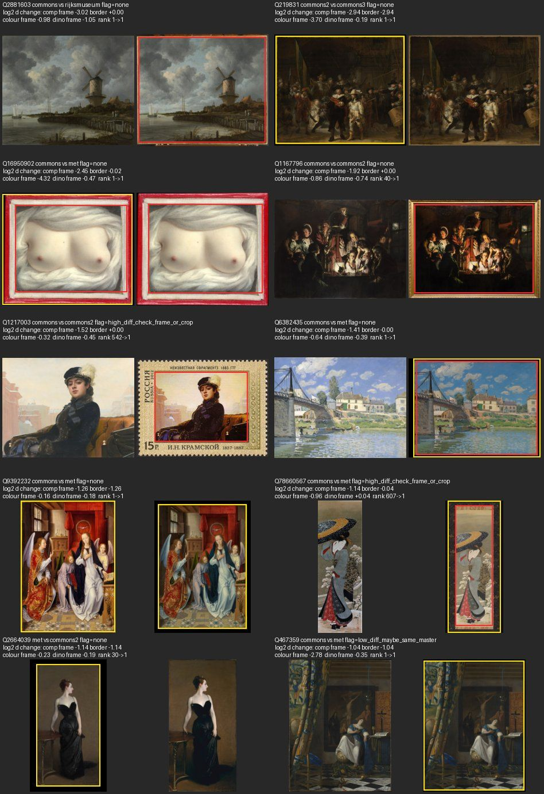

The ten pairs the automatic crop helped most, with crop boxes drawn (yellow `border`, red `frame`). Black surrounds and a gilt frame are trimmed. Wright's *Air Pump* goes from rank 40 to 1, and a hanging scroll cut out of its mount from rank 607 to 1.

## Experiment 3: colour, fusion, lenses and period

[exp_fusion/README.md](../exp_fusion/README.md)

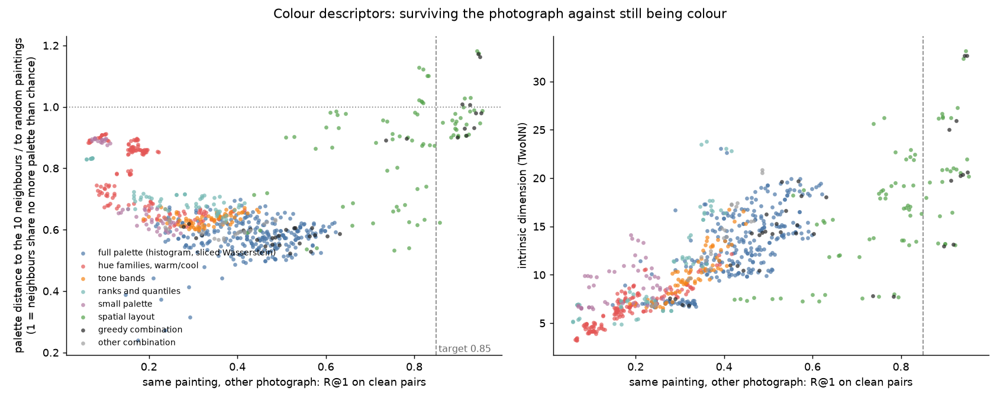

Each point is a colour descriptor variant. Left: how often the other photograph of the same painting is the nearest neighbour (R@1), against how much palette a painting shares with its ten neighbours (1 means no more than random paintings). Nothing that still looks like colour gets past R@1 0.63, and every point right of the 0.85 line is a spatial layout.

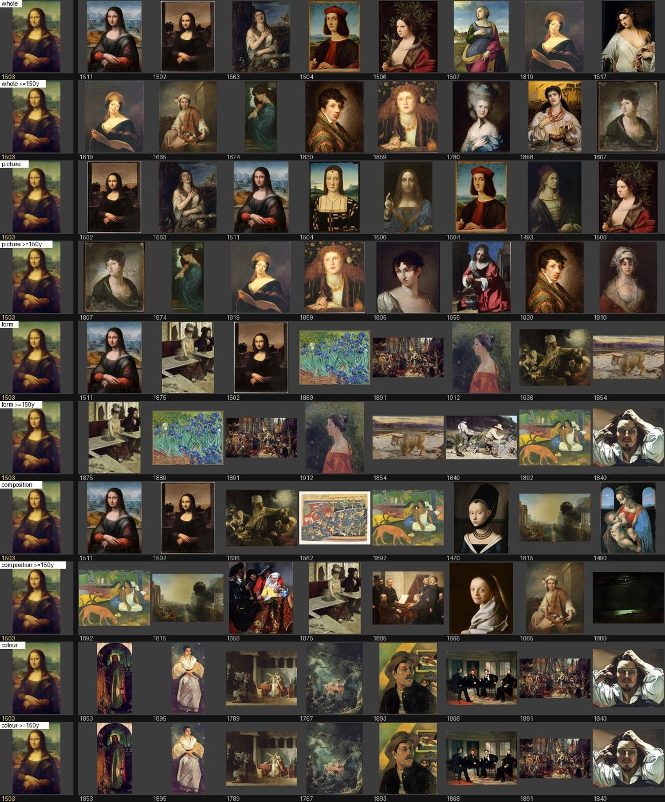

The *Mona Lisa* (1503) under five lenses. Each lens has two rows, its nearest eight and its nearest eight at least 150 years away; years are under the thumbnails. Under Whole picture the far row is half-length portraits from 1665 to 1874.

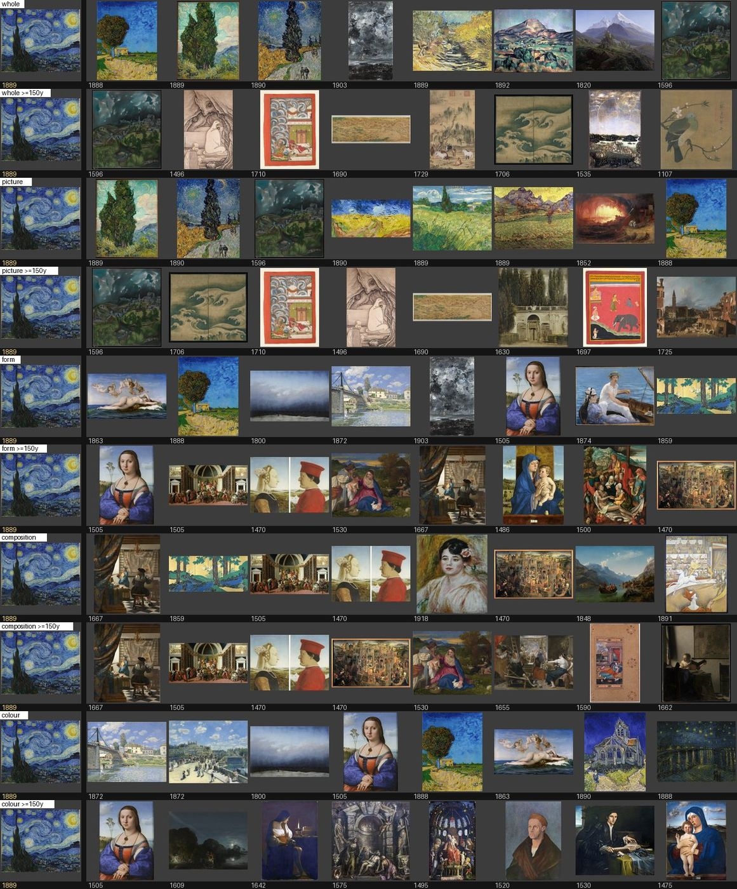

*The Starry Night* (1889), same layout. At 150 years, Whole picture returns *View of Toledo*, a Japanese screen of waves, an Indian page with scrolling clouds and a Leonardo-like deluge drawing, which share the swirl. The other four share little.

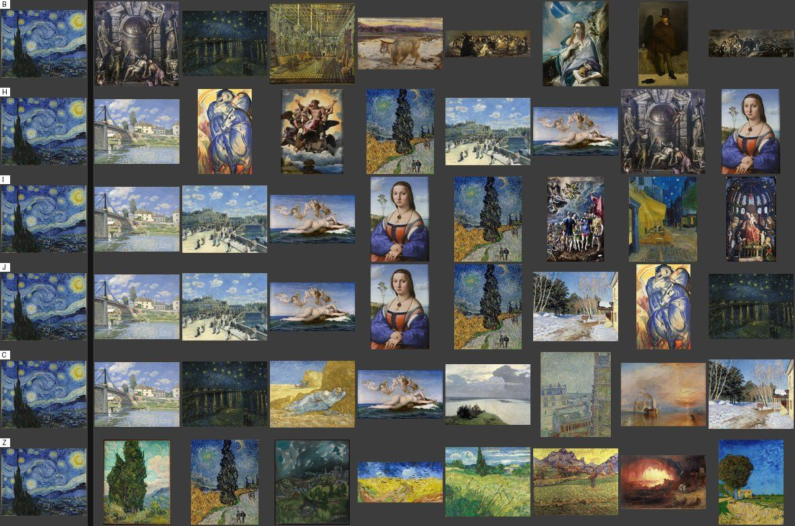

*The Starry Night* under colour descriptors. Row B removes the overall tint and returns a brown Pietà and a Goya. Rows H, I and J keep the tint and are the only rows where the painting is surrounded by blue pictures. The last row is the picture block, for comparison.

The page for browsing the 1,972 pilot paintings by lens is kept at [exp_fusion/demo_page/index.html](../exp_fusion/demo_page/index.html). It needs the data under `data/painting2vec/demo/`, which is not committed.

## Describer blocks: Subject and Form from fixed fields

[exp_describer_blocks/README.md](../exp_describer_blocks/README.md)

A model marked 300 pilot paintings on fixed fields, and each field group became a block. Each row is a seed and its eight nearest among the 300. No names are shown.

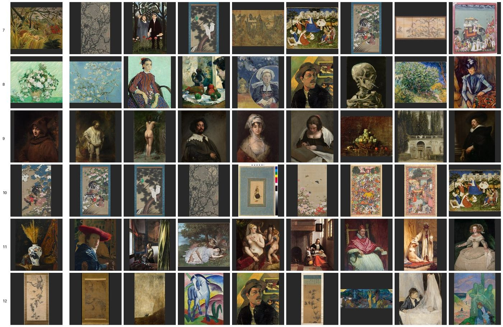

Describer-manner, seeds 7 to 12. Rousseau's tiger (row 7) gets ink plum blossom, Jakuchū twice, the Upper Rhenish paradise garden, a gold screen and an Indian procession: flat, outlined, patterned. Van Gogh's roses (row 8) get only Van Gogh, Gauguin and Cézanne. The ink grapevine (row 12) sits with Gauguin and Franz Marc because the block has no colour in it.

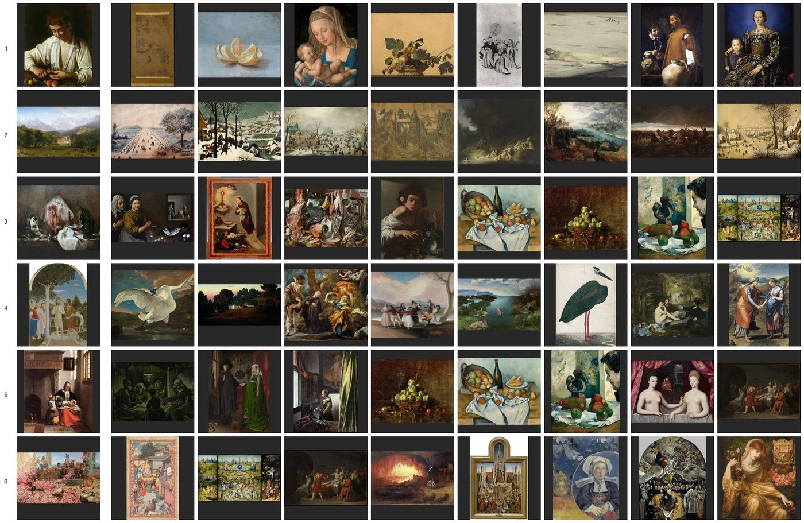

Describer-subject, seeds 1 to 6. Bierstadt's mountain landscape (row 2) gets snow scenes, an American naive view and an East Asian landscape, across four centuries. The boy peeling fruit (row 1) splits into fruit still lifes and figures: the checklist says what is present, not what the picture is of.

## Rights

Every painting on these sheets is from the pilot set: each named painter died before 1926, or no death date is recorded and the work is from before 1870, and the Commons file is marked public domain, CC0 or Public Domain Mark. The invariance sheets also show second photographs from museum open-access programmes (CC0 or Public Domain Mark) and from Commons files marked public domain or CC0. See [dataset/README.md](../dataset/README.md) and [rights/README.md](../rights/README.md).

## Regenerating

```bash
uv run --no-project --with pillow python experiments/painting2vec/figures/make_figures.py [DATA_DIR]
```

`DATA_DIR` defaults to `data/painting2vec`.
